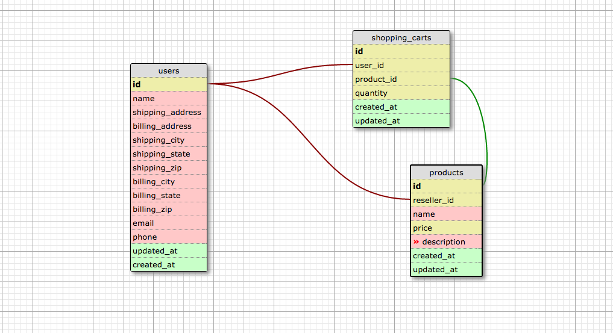
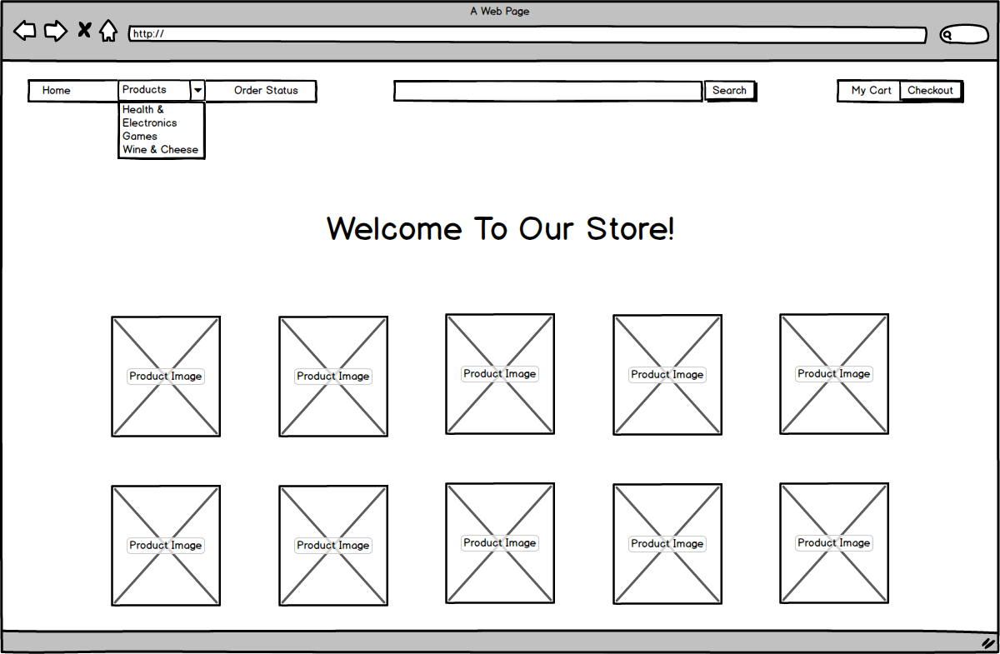
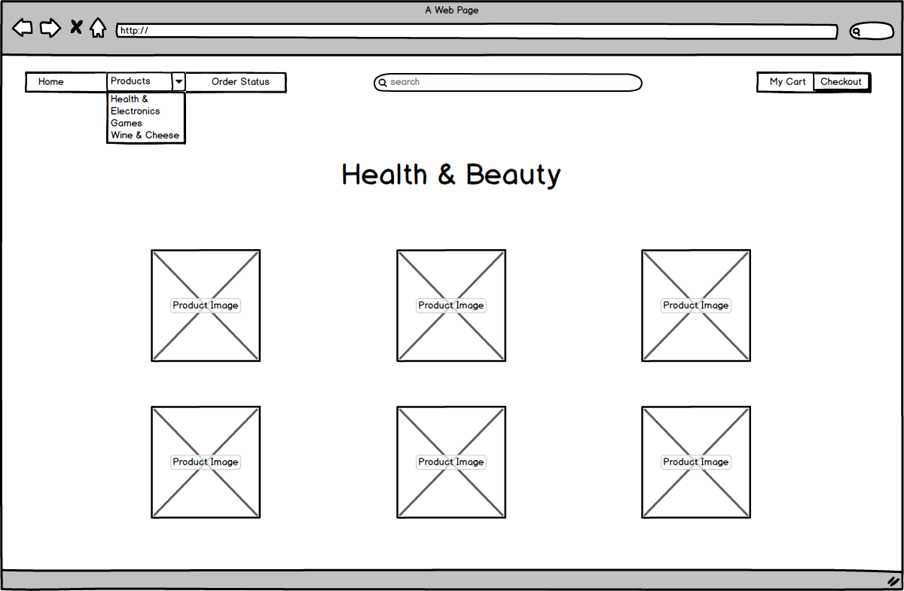
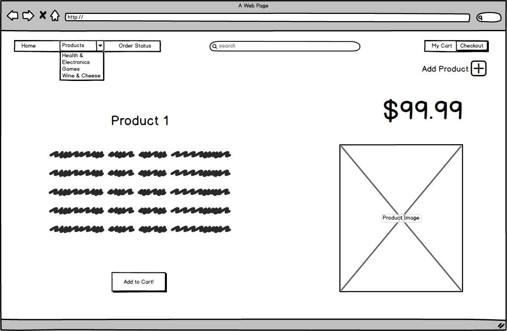
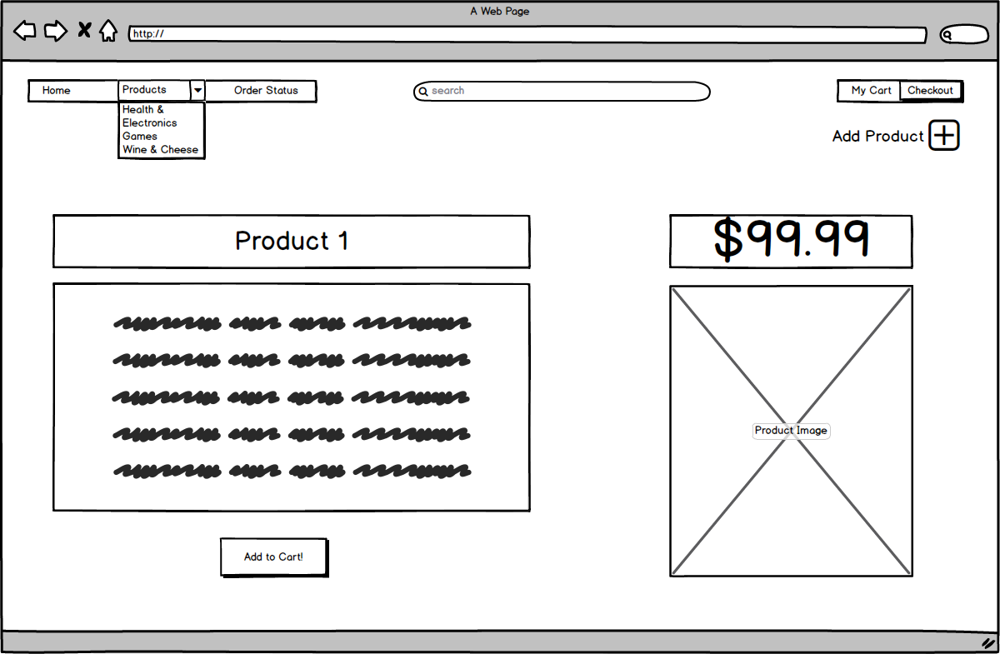
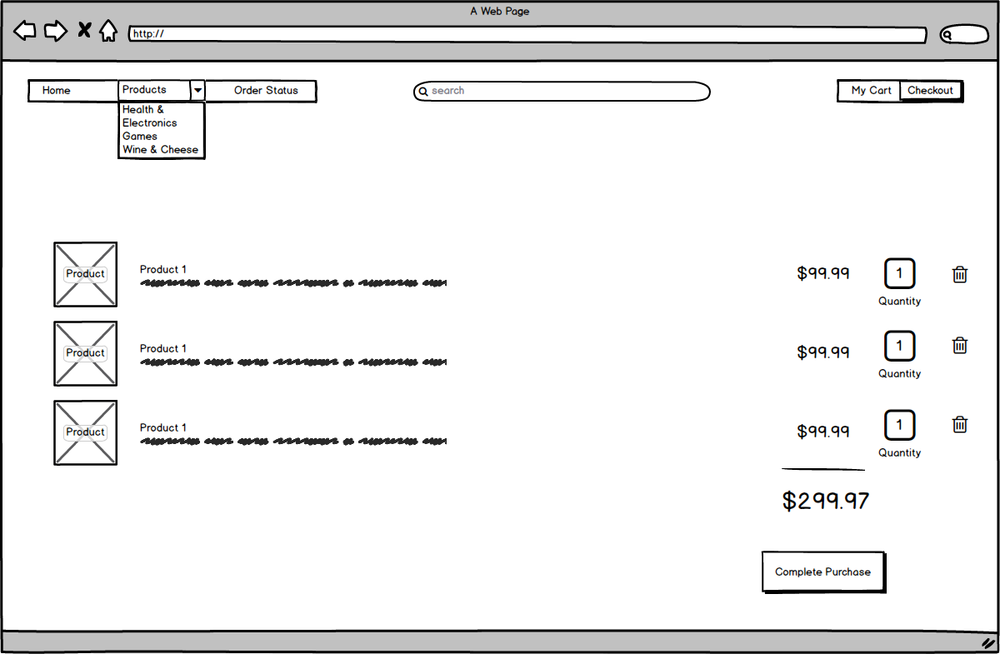

## Ye Olde Online Shoppe

### User Stories
* User can see all items available for sale.  
* User can purchase any item available for sale.  
* User can see purchase history.  
* User can add items to a shopping cart.  
* User can remove items from the shopping cart.  
* User can can view detail information about an item.  

### Client User Stories  
* Client can add products to sell.  
* Client can remove products from sale.  
* Client can view total sales for an item, or total overall sales.  
* Client can see purchaser information.  
* Client can edit items. 
  
### Live Heroku Site Link
[Crabazon](https://crabazon.herokuapp.com)

### Schema Design for Online Shop


### Wire Frames

Home Page


Category View


Product Page


Add Product Page


Checkout Page

### Deployment

The site runs on the app host from a checkout of `master` in `~/crabazon`, against PostgreSQL 18. To deploy:

```sh
git pull
docker compose up -d web
```

Settings live in `.env`. To keep the database password out of it, set `PGPASS_FILE` to a libpq password file on the host and leave the password out of `DATABASE_URL`:

```sh
PGPASS_FILE=/home/<user>/.pgpass
DATABASE_URL=postgres://crabazon_app@<new-db-host>:5432/crabazon
```

Compose mounts that file read-only into `web`. Without `PGPASS_FILE`, the password in `DATABASE_URL` works as before.

Don't rebuild the image on the app host (`--build` or `docker compose build`): it is based on Debian 10, whose package repositories are archived, so the build is likely to fail. The Ruby and Rails upgrade replaces it.
